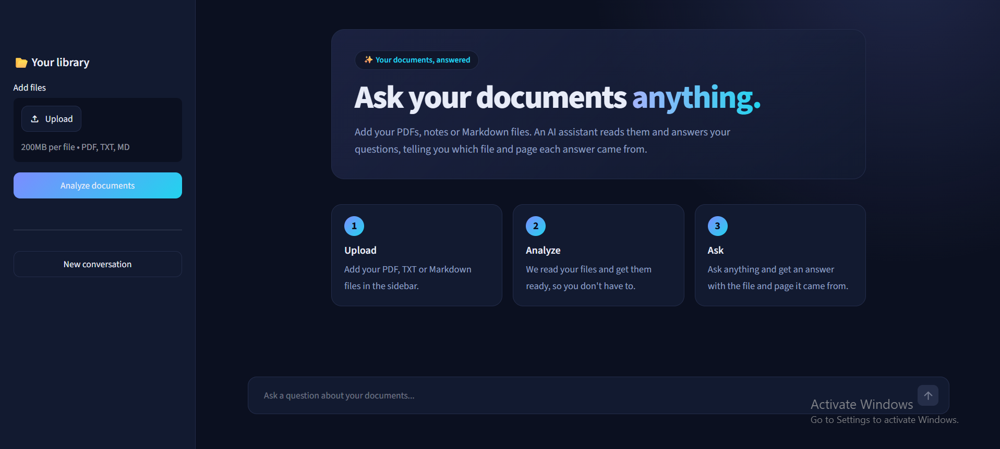

# DocChat
# Agentic RAG Document Assistant

> Upload PDF, Markdown, or text files and ask questions in plain language. An AI agent searches your documents, checks the evidence with specialist subagents, and answers with the file name and page number so you can verify every claim.

[](https://www.python.org/)
[](https://www.langchain.com/)
[](https://streamlit.io/)
[](https://groq.com/)
[](https://docs.astral.sh/uv/)

---

## What Is This?

This project is an **agentic retrieval-augmented generation (RAG) application**. Instead of asking a language model to answer from memory, the app reads the user's own documents, finds the most relevant passages, hands each passage to a specialist subagent for analysis, and combines the results into one grounded answer.

Two design goals shaped the project:

- **Verifiable answers.** Every claim is cited as `(document name, page N)`, so a reader can open the original file and check it.
- **Simple for end users.** The interface never shows technical terms. Users upload, analyze, and ask.

Retrieval runs locally and for free. Only the final answering step calls a hosted model.

---

## Demo



*Replace this with a screenshot of your app showing a finished answer with citations.*

---

## Features

- Upload multiple `.pdf`, `.txt`, and `.md` files at once.
- Extract text page by page with `pypdf`, keeping the page number of every passage.
- Split pages into overlapping chunks that still remember their source file and page.
- Create embeddings **locally** with `fastembed` (no embedding API key or cost).
- Search with LangChain's `InMemoryVectorStore`.
- Let the agent decide when to search, what to search for, and how many times.
- Save retrieved passages to the agent's virtual filesystem and analyze them with parallel `chunk-analyst` subagents.
- Answer with `(document name, page N)` citations and never expose internal file names.
- Keep the chat history so follow-up questions work.
- Show a plain-language "How I found this answer" panel for each response.
- Warn the user when the selected files changed and need to be analyzed again.
- Dark, responsive interface with suggested starter questions.

---

## How It Works

1. **Upload**: the user adds one or more supported documents.
2. **Parse**: PDFs become one LangChain `Document` per page; text and Markdown files are decoded as UTF-8.
3. **Chunk**: `RecursiveCharacterTextSplitter` creates 1,000-character chunks with 200 characters of overlap and keeps each chunk's source metadata.
4. **Embed**: `fastembed` converts each chunk into a 384-dimensional vector on the local machine.
5. **Index**: vectors and original text are stored in an `InMemoryVectorStore` for the current session.
6. **Search**: the agent calls the `search_documents` tool, which finds the closest chunks to its query.
7. **Delegate**: each retrieved chunk is saved as a file under `/retrieved/` with a ready-made citation line, and one `chunk-analyst` subagent reads each file.
8. **Synthesize**: the main agent merges the subagent reports into a final answer with document and page citations.

```text
Uploaded PDF / TXT / Markdown files
                |
                v
   Page-level text extraction (pypdf)
                |
                v
   Recursive splitting (1,000 / 200 overlap)
                |
                v
   Local embeddings (fastembed, 384 dimensions)
                |
                v
        InMemoryVectorStore
                |
                v
   Agent calls search_documents(query)
                |
                v
   /retrieved/chunk_N.md  (with Citation line)
                |
                v
   Parallel chunk-analyst subagents
                |
                v
   Final answer: facts + (document, page N)
```

---

## Project Structure

```text
agentic-rag/
├── .streamlit/
│   └── config.toml        # Dark theme and server settings
├── files/                 # Sample PDFs for the test scripts
├── app.py                 # Streamlit interface
├── agent.py               # Builds the main Deep Agent (Groq model)
├── subagents.py           # chunk-analyst subagent definition
├── tools.py               # search_documents tool + citation helper
├── prompts.py             # Workflow, delegation, and analyst prompts
├── loaders.py             # PDF/TXT/MD loading into Documents
├── chunking.py            # Splits documents into chunks
├── embeddings.py          # LangChain wrapper around fastembed
├── vector_store.py        # Builds the in-memory vector store
├── check_tool.py          # Tests retrieval without the agent
├── test.py          # Runs sample questions and prints the agent trace
├── pyproject.toml         # Project metadata and dependencies
├── uv.lock                # Reproducible dependency lockfile
└── README.md
```

### Module responsibilities

| File | Responsibility |
|---|---|
| `app.py` | Upload, analysis, chat state, citation cleanup, plain-language UI |
| `loaders.py` | Reads files from disk or from uploaded bytes and returns page-level `Document` objects |
| `chunking.py` | Splits documents and assigns each chunk a unique `chunk_id` |
| `embeddings.py` | Adapts `fastembed` to LangChain's `Embeddings` interface |
| `vector_store.py` | Embeds chunks and stores vectors with their original text and metadata |
| `tools.py` | Exposes semantic search as an agent tool and writes retrieved chunks to the agent filesystem |
| `subagents.py` | Defines the `chunk-analyst` specialist |
| `prompts.py` | Holds every prompt: workflow, delegation, citation rules, and prompt-injection safety |
| `agent.py` | Creates the Deep Agent with the Groq model, the search tool, and the subagent |
| `check_tool.py` | Verifies that retrieval returns relevant chunks, independent of the agent |
| `test.py` | Runs a greeting, an out-of-scope question, and a comparison question and prints the full trace |

---

## Getting Started

### Prerequisites

| Requirement | Purpose |
|---|---|
| Python 3.12+ | Application runtime |
| `uv` | Dependency installation and command execution |
| Groq API key | Chat model access (free tier available) |

Check your installed versions:

```bash
python --version
uv --version
```

If `uv` is not installed, follow the [official installation guide](https://docs.astral.sh/uv/getting-started/installation/).

### 1. Clone the repository

```bash
git clone https://github.com/abdelrahmansaeed845-ux/DocChat.git
```

### 2. Install dependencies

```bash
uv sync
```

This creates a local virtual environment and installs the versions pinned in `uv.lock`.

### 3. Configure the API key

Create a `.env` file in the project root:

```env
GROQ_API_KEY=your_groq_api_key_here
```

You can create a key in the [Groq console](https://console.groq.com/). The `.gitignore` excludes `.env`. Never commit a real API key.

### 4. Launch the app

```bash
uv run streamlit run app.py
```

Open the local URL printed by Streamlit, usually `http://localhost:8501`.

> The first analysis downloads a small embedding model (about 100 MB). Later runs reuse it.

### 5. Use the app

1. Add one or more PDF, TXT, or Markdown files in the sidebar.
2. Click **Analyze documents** and wait for the "Ready" status.
3. Ask a question, or click one of the suggested questions.
4. Read the answer and open **How I found this answer** to see what the assistant did.
5. Ask follow-up questions, or click **New conversation** to start over.

---

## Run the Test Scripts

These scripts are for development. They use the sample PDFs in `files/`.

Check retrieval on its own, without the agent:

```bash
uv run python check_tool.py
```

Run three sample questions and print the agent's tool calls:

```bash
uv run python test.py
```

The three questions check different behaviors:

| Question | Expected behavior |
|---|---|
| `hi` | Direct reply, no tools |
| `How do I bake bread?` | Searches the documents, then says they don't cover it |
| `Compare what the two documents say about...` | Several searches, several `chunk-analyst` tasks, a cited answer |

To use your own files, update the paths inside these scripts, or just use the Streamlit app.

---

## Key Learning Concepts

### Retrieval-augmented generation

RAG gives the language model relevant source passages at question time, so the answer depends on the uploaded documents rather than only on the model's training data.

### Chunking and overlap

Whole pages produce blurry embeddings and can exceed the embedding model's input limit. Smaller chunks give more precise search. The 200-character overlap keeps ideas intact when a sentence crosses a chunk boundary.

### Embeddings and semantic search

A question and the chunks are converted to vectors by the same embedding model. Chunks with similar meaning end up close together, so search finds relevant text even when the words differ. Vectors are only used for finding text. The language model reads the original text, which is stored beside each vector.

### Two models, two jobs

A small local embedding model handles search. A large hosted chat model handles reasoning and writing. Using the same embedding model for documents and questions is required, because vectors from different models cannot be compared.

### Agentic retrieval

Search is exposed as a tool, not run unconditionally. The agent can skip searching for a greeting, search several times for a comparison, and refine a weak query.

### Subagent delegation

Retrieved chunks are written to files, and each file is analyzed by its own subagent. The coordinator only receives short reports, which keeps its context small and lets analysis run in parallel.

### Citations for verification

Each chunk file starts with a `Citation:` line holding the document name and page. The agent copies it instead of inventing one, and a cleanup step in the app removes any leaked internal file references.

### Prompt-injection boundaries

The prompts tell every agent to treat retrieved text as reference data and to ignore instructions found inside it.

---

## Tech Stack

| Layer | Technology | Role |
|---|---|---|
| Language | Python 3.12+ | Application runtime |
| UI | Streamlit | Upload and chat interface |
| RAG framework | LangChain | Documents, text splitting, vector store, tools |
| Agent framework | Deep Agents | Main agent, subagents, task delegation, virtual filesystem |
| LLM | `openai/gpt-oss-120b` on Groq | Reasoning and answer generation |
| Embeddings | `fastembed` with `BAAI/bge-small-en-v1.5` | Local semantic search vectors |
| PDF parsing | pypdf | Page-level text extraction |
| Configuration | python-dotenv | Loads `GROQ_API_KEY` from `.env` |
| Package management | uv | Environment and dependency management |

---

## Configuration

Settings live in code and are easy to change while learning:

| Setting | Current value | Location |
|---|---:|---|
| Chat model | `openai/gpt-oss-120b` (Groq) | `agent.py` |
| Model temperature | `0.1` | `agent.py` |
| Max output tokens | `4096` | `agent.py` |
| Embedding model | `BAAI/bge-small-en-v1.5` | `embeddings.py` |
| Chunk size | `1000` characters | `chunking.py` |
| Chunk overlap | `200` characters | `chunking.py` |
| Chunks per search (`TOP_K`) | `4` | `app.py` |
| Concurrent analysts | `2` | `app.py` |

If Groq's free tier returns rate-limit errors, lower `TOP_K` or the number of concurrent analysts.

---

## Design Decisions

| Choice | Why it is useful here |
|---|---|
| Local embeddings with `fastembed` | Search is free and private, and no embedding API key is needed |
| Page-level documents | Every chunk keeps its file and page, which makes real citations possible |
| In-memory vector store | Keeps the demo simple and avoids running a database |
| Explicit **Analyze documents** button | Avoids re-embedding the files on every Streamlit rerun |
| Content hash of the uploaded files | Warns the user when the files differ from the analyzed set |
| Chunks saved as files for subagents | The coordinator passes a file path instead of copying long passages |
| `Citation:` line inside each chunk file | The model copies a ready citation instead of inventing one |
| Citation cleanup in the app | A safety net for the rare case the model mentions an internal file name |
| Plain-language interface | Non-technical users see "Analyze" and "How I found this answer", not chunks or tool calls |
| Prompts in one file | Rules can be improved without touching application code |

---

## Limitations

- The vector index and chat history live in memory and disappear when the session ends.
- Scanned PDFs have no text layer, so they are rejected. OCR is not included.
- The default embedding model is English-focused. Retrieval quality will be lower for Arabic or other languages until a multilingual model is used.
- Page numbers follow the PDF viewer's page counter, which can differ from numbers printed on the page itself.
- Each search retrieves only four chunks, which may be too few for broad questions on large collections.
- Subagents add extra model calls, so answers are slower than single-call RAG, and the free Groq tier can rate-limit heavy use.
- Answers can still contain mistakes and should be checked against the original documents for high-stakes use.
- Deep Agents is a young library and its parameters change between releases, so pin the versions in `uv.lock`.
- There is no automated test suite and no user authentication.

---

## Ideas for Further Development

- Add persistent vector storage with Chroma, FAISS, or pgvector.
- Show the retrieved passages beside each answer, with a link to the source page.
- Switch to a multilingual embedding model for Arabic and mixed-language documents.
- Add OCR for scanned PDFs and images.
- Support DOCX, HTML, CSV, and web pages.
- Stream the answer as it is generated.
- Add a reranking step to improve retrieval precision.
- Build a small evaluation set to measure retrieval quality and groundedness.
- Cache embeddings so the same file is not processed twice.
- Add unit tests for loading, chunking, retrieval, and citation cleanup.
- Add authentication and saved conversations for multi-user deployment.

---

## Security and Privacy

- Never commit `.env` or any real credentials.
- Embeddings are created locally, but the retrieved passages and the question are sent to Groq to generate the answer.
- Review Groq's data-handling policy before uploading confidential or regulated documents.
- Treat generated answers as assistance, not authoritative advice.
- For production use, add file-size limits, malware scanning, access controls, logging safeguards, and stronger prompt-injection defenses.